# DSML Lab Assignment 1 — Gradient Descent as a Dynamical System

**Solution.** All code is in [`gd_assignment1.py`](gd_assignment1.py) (Python + NumPy + Matplotlib). Running `python gd_assignment1.py` prints every number quoted below and writes the figures into [`figures/`](figures/). Each section follows the cycle **predict → compute → visualize → explain**.

Notation: $k$ is the iteration index, $\mathbf e_k=\mathbf x_k-\mathbf x^*$ is the error, and $q$ (or $1-\eta\lambda$) is an error multiplier. **Status** is the numerical stop reason returned by the code. **Behavior** is the mathematical classification derived from the update rule. These two are kept separate everywhere.

---

## Problem 0: Conceptual overview

### a) Roles of the symbols, state space, evolution law

$$\mathbf x_{k+1}=\mathbf x_k-\eta\nabla f(\mathbf x_k)=F_\eta(\mathbf x_k)$$

| Symbol | Role |
|---|---|
| $\mathbf x_k\in\mathbb R^d$ | **state** of the system at discrete time $k$ (the current parameters) |
| $\eta>0$ | **step size / learning rate**: a fixed control parameter that scales every step |
| $\nabla f(\mathbf x_k)$ | **local direction of steepest ascent**; moving against it decreases $f$ locally. It is the "force" of the system. |
| $k=0,1,2,\dots$ | **discrete time** (iteration counter) |

* **State space:** $\mathbb R^d$, the parameter space.
* **Evolution law:** the map $F_\eta:\mathbb R^d\to\mathbb R^d$, $F_\eta(\mathbf x)=\mathbf x-\eta\nabla f(\mathbf x)$. A trajectory is the orbit $\mathbf x_0, F_\eta(\mathbf x_0), F_\eta^2(\mathbf x_0),\dots$
* **Autonomy:** when $f$ and $\eta$ are fixed, $F_\eta$ does not depend on $k$. The same rule is applied at every step, and the next state depends only on the current state, not on the time at which it is reached. Learning-rate schedules $\eta_k$ or mini-batch gradients that change with $k$ would make the system non-autonomous.

### b) Fixed points

$$\mathbf x^*=F_\eta(\mathbf x^*)\iff \mathbf x^*=\mathbf x^*-\eta\nabla f(\mathbf x^*)\iff \eta\nabla f(\mathbf x^*)=\mathbf 0\iff \nabla f(\mathbf x^*)=\mathbf 0\quad(\eta>0).$$

So the fixed points of gradient descent are exactly the **stationary points** of $f$, and this does not depend on $\eta$.

**A zero gradient does not always identify a minimum.** For example, $f(x)=-x^2$ has a maximum at 0, $f(x_1,x_2)=x_1^2-x_2^2$ has a saddle at the origin, and $f(x)=x^3$ has an inflection point at 0. All of these are fixed points of $F_\eta$. Second-order information (the Hessian) or convexity is needed to tell them apart.

**Remaining close vs. converging.**
* *Stable (Lyapunov):* for every $\varepsilon>0$ there is a $\delta>0$ such that $\|\mathbf x_0-\mathbf x^*\|<\delta\Rightarrow\|\mathbf x_k-\mathbf x^*\|<\varepsilon$ for all $k$. Trajectories that start close **remain close**.
* *Asymptotically stable:* stable **and** $\mathbf x_k\to\mathbf x^*$ for every start close enough. Trajectories **converge**.

A system can remain close without converging. The 2-cycle at $\eta=1$ in Problems 1 and 2 keeps $\|\mathbf e_k\|=\|\mathbf e_0\|$ forever, and the flat direction in Dataset 2 (E3) also stays close without converging.

### c) Dimensions of the parameter spaces

| Problem | Input features | Trainable parameters = state dimension $d$ |
|---|---|---|
| Problem 1 | — | $d=1$ ($x$) |
| Problem 2 | — | $d=2$ ($x_1,x_2$) |
| Dataset 1 (Problem 3A) | 1 ($x$) | $d=2$ ($w,b$) |
| Dataset 2 (Problem 3B) | 2 ($x_1,x_2$) | $d=3$ ($w_1,w_2,b$) |

The intercept $b$ is a trainable parameter, so the number of parameters is the number of features plus one. The data $(X,Y)$ are fixed constants of the evolution law, not part of the state.

### The reusable optimizer

```python
def gradient_descent(f, grad_f, x0, eta, tol=1e-6, max_iter=10000, max_norm=1e6):
    x = np.array(x0, dtype=float).reshape(-1).copy()          # always a float vector
    g = np.asarray(grad_f(x), dtype=float).reshape(-1)
    xs, losses, gnorms = [x.copy()], [float(f(x))], [float(np.linalg.norm(g))]

    def finite(x, loss, g):
        return np.all(np.isfinite(x)) and np.isfinite(loss) and np.all(np.isfinite(g))

    status, n_updates = None, 0
    if not finite(x, losses[0], g):
        status = "nonfinite"
    elif tol is not None and gnorms[0] < tol:                   # initial state already converged
        status = "converged"

    while status is None:
        if n_updates >= max_iter:
            status = "max_iter"
            break
        x = x - eta * g
        n_updates += 1
        loss = float(f(x))
        g = np.asarray(grad_f(x), dtype=float).reshape(-1)
        xs.append(x.copy()); losses.append(loss); gnorms.append(float(np.linalg.norm(g)))
        if not finite(x, loss, g):
            status = "nonfinite"
        elif np.linalg.norm(x) > max_norm:
            status = "safety_stop"
        elif tol is not None and gnorms[-1] < tol:
            status = "converged"

    return {"x": np.array(xs), "loss": np.array(losses), "grad_norm": np.array(gnorms),
            "n_updates": n_updates, "status": status}

converge = lambda f, g, x0, eta: gradient_descent(f, g, x0, eta, tol=1e-6, max_iter=10000)
compare  = lambda f, g, x0, eta: gradient_descent(f, g, x0, eta, tol=None, max_iter=40)
```

* **Convergence runs** stop when $\|\nabla f(\mathbf x_k)\|_2<10^{-6}$, including at $k=0$, or after 10 000 updates.
* **Comparison runs** use `tol=None` and perform exactly 40 updates unless a safety check fires.
* **Safety checks** stop on a non-finite parameter, loss or gradient (`nonfinite`) and on $\|\mathbf x_k\|_2>10^6$ (`safety_stop`). A copy of every state, including $\mathbf x_0$, is stored.

---

## Problem 1: Gradient descent in 1D

$$f(x)=x^2+3x+2,\qquad f'(x)=2x+3,\qquad f''(x)=2.$$

Setting $f'(x^*)=0$ gives $x^*=-\tfrac32$ and $f(x^*)=-\tfrac14$. Because $f''>0$, this is the unique global minimizer. A useful identity is
$$f(x)-f(x^*)=(x+1.5)^2=e^2,\qquad f'(x)=2e .$$

```python
f1 = lambda x: float(x[0]**2 + 3*x[0] + 2)
g1 = lambda x: np.array([2*x[0] + 3])
```

### Task 1.1: Descent path ($\eta=0.1$, $x_0=10$)

**Prediction:** $e_{k+1}=0.8\,e_k$, so the iterates move monotonically toward $-1.5$ without crossing it.

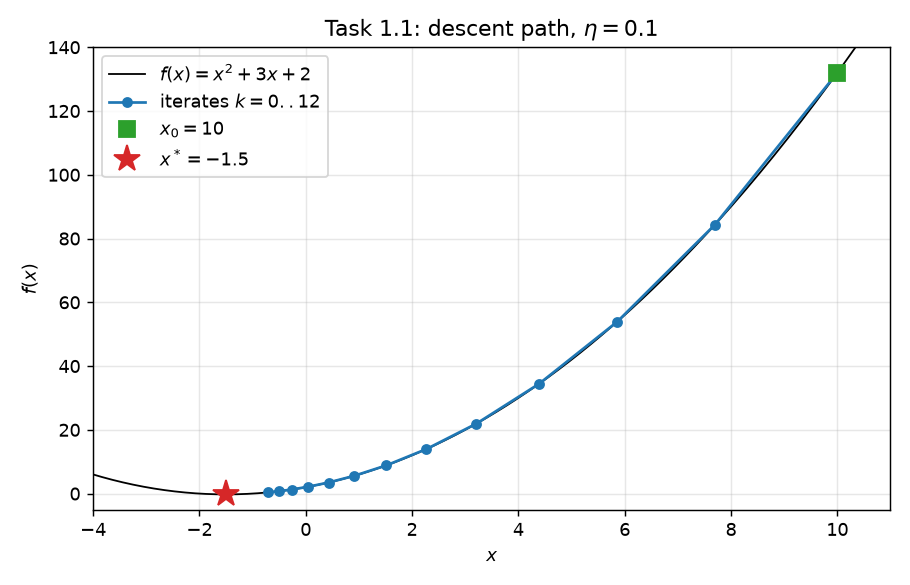

| final $x$ | $f(x)$ | $\lvert f'(x)\rvert$ | updates | status |
|---|---|---|---|---|
| $-1.4999995039$ | $-0.25$ | $9.92\times10^{-7}$ | 76 | `converged` |

The final iterate agrees with $x^*=-1.5$ to $5\times10^{-7}$, which is consistent with $|f'|=2|e|<10^{-6}$. The markers move down the parabola in big steps at first and then cluster near the minimum, because each step is proportional to the slope. The plot lives in the $(x,f(x))$ plane, but the state is the single number $x_k$, so the dynamics is one-dimensional.

### Task 1.2: The learning rate as a control parameter ($x_0=10$)

**a) Predictions.** These come from $e_{k+1}=q\,e_k$ with $q=1-2\eta$ (derived in Task 1.4), made before running the code.

| $\eta$ | $q=1-2\eta$ | Predicted behavior |
|---|---|---|
| 0.1 | $+0.8$ | approaches $x^*$ monotonically, **no crossing**, slowly |
| 0.5 | $0$ | reaches $x^*$ **in one step** |
| 0.6 | $-0.2$ | **oscillates** around $x^*$ and converges fast |
| 0.9 | $-0.8$ | **oscillates** around $x^*$ and converges slowly |
| 1.0 | $-1$ | **bounded 2-cycle** $10\leftrightarrow-13$ |
| 1.1 | $-1.2$ | oscillates with growing amplitude, **moves away** |

**b) Trajectories (40-update comparison runs).**

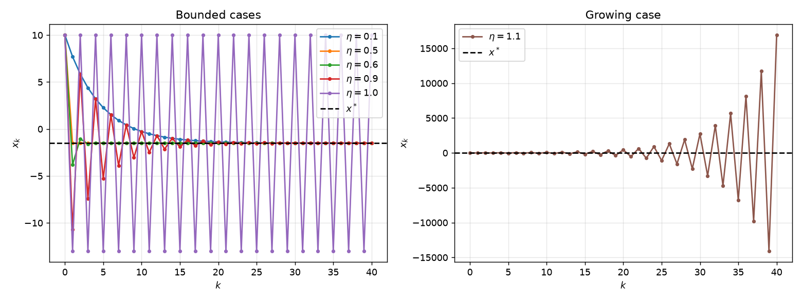

**c) Error on a log scale** (exact zeros omitted).

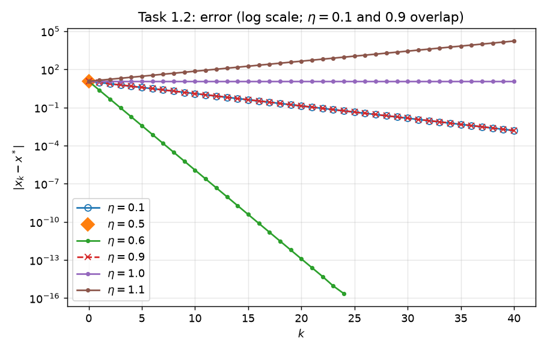

| $\eta$ | Init. | Updates | Status (40-run) | final $\lvert f'\rvert$ | final $f$ | Behavior | Convergence run |
|---|---|---|---|---|---|---|---|
| 0.1 | 10 | 40 | `max_iter` | $3.06\times10^{-3}$ | $-0.249998$ | monotone convergence | **76** updates, `converged` |
| 0.5 | 10 | 40 | `max_iter` | $0$ | $-0.25$ | one-step convergence | **1** update, `converged` |
| 0.6 | 10 | 40 | `max_iter` | $0$ | $-0.25$ | oscillatory convergence | **11** updates, `converged` |
| 0.9 | 10 | 40 | `max_iter` | $3.06\times10^{-3}$ | $-0.249998$ | oscillatory convergence | **76** updates, `converged` |
| 1.0 | 10 | 40 | `max_iter` | $23$ | $132$ | 2-cycle (bounded, not convergent) | 10 000 updates, `max_iter` |
| 1.1 | 10 | 40 | `max_iter` | $3.38\times10^{4}$ | $2.86\times10^{8}$ | divergent oscillation | 63 updates, `safety_stop` |

**Comparison with the predictions.** Every prediction is confirmed.

* With $\eta=0.5$, $x_1=10-0.5\cdot23=-1.5$ exactly, so on the log plot only the $k=0$ point is visible.
* With $\eta=0.6$, the error falls by a factor of 5 per step. From $k=25$ on, $|e_k|$ is below the floating-point spacing at 1.5, so $x_k$ becomes exactly $-1.5$ and the zeros are omitted.
* With $\eta=1.0$, the orbit is $10,-13,10,-13,\dots$ The `max_iter` status of the convergence run does **not** mean divergence: the orbit is bounded and periodic.
* With $\eta=1.1$, the 40-update run does not trip the safety check ($|x_{40}|\approx1.7\times10^4$). The longer convergence run hits $|x|>10^6$ after 63 updates. The `safety_stop` is a numerical safeguard. The *proof* of divergence is $|e_k|=1.2^k|e_0|\to\infty$.
* The update counts agree with $k=\lceil\ln(2|e_0|/10^{-6})/\ln(1/|q|)\rceil$, which gives 76 for $|q|=0.8$ and 11 for $|q|=0.2$.

**Do oscillations in $x_k$ imply that $f(x_k)$ increases? No.** Since $f(x_k)-f(x^*)=e_k^2=q^{2k}e_0^2$, the sign of $q$ disappears. For any $|q|<1$, the loss gap decreases monotonically, even when $x_k$ jumps from one side of $x^*$ to the other. For $\eta=0.9$, the iterates $x_k=10,-10.7,5.86,-7.39,3.21,\dots$ alternate sides, while $f(x_k)=132,84.4,53.9,34.4,21.9,\dots$ strictly decreases. At $\eta=1$ ($|q|=1$), the loss stays at $132$ and never decreases. At $\eta=1.1$, it increases.

**Are $\eta=0.1$ and $\eta=0.9$ equally fast? Yes.** The rate is governed by $|q|$, and $|1-0.2|=|1-1.8|=0.8$. Both satisfy $|e_k|=0.8^k\cdot11.5$. The two curves in the log-error plot coincide exactly, and both runs need 76 updates. One approaches from one side, the other alternates sides, but the error norm cannot tell them apart.

### Task 1.3: The role of the initial condition ($\eta=0.1$)

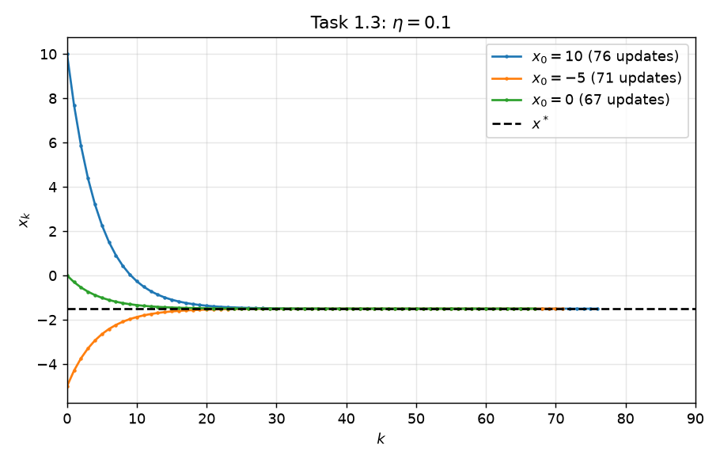

| $x_0$ | $\lvert x_0-x^*\rvert$ | Updates | Status | final $x$ | final $\lvert f'\rvert$ | final $f$ |
|---|---|---|---|---|---|---|
| 10 | 11.5 | 76 | `converged` | $-1.4999995039$ | $9.92\times10^{-7}$ | $-0.25$ |
| −5 | 3.5 | 71 | `converged` | $-1.5000004607$ | $9.22\times10^{-7}$ | $-0.25$ |
| 0 | 1.5 | 67 | `converged` | $-1.4999995179$ | $9.64\times10^{-7}$ | $-0.25$ |

All three runs approach the **same** minimizer $x^*=-1.5$, which is the unique stationary point of a strictly convex function. Only the trajectories differ. $x_0=-5$ approaches from the left, and the other two approach from the right.

The update count is controlled only by the **initial distance** $|e_0|=|x_0-x^*|$. Since $|f'(x_k)|=2(0.8)^k|e_0|$, convergence needs $k>\ln(2|e_0|/10^{-6})/\ln 1.25$, which gives 76, 71 and 67. The count grows only *logarithmically* with the distance. The side of $x^*$ on which $x_0$ lies does not matter.

### Task 1.4: Exact stability analysis

Use $f'(x^*)=2x^*+3=0$:
$$e_{k+1}=x_{k+1}-x^*=x_k-\eta(2x_k+3)-x^*=e_k-\eta\big(2x_k+3-(2x^*+3)\big)=e_k-2\eta e_k .$$

$$\boxed{e_{k+1}=q(\eta)\,e_k,\quad q(\eta)=1-2\eta,\quad e_k=(1-2\eta)^k e_0.}$$

The relation is exact, not linearized, because $f'$ is affine.

* **Global asymptotic stability** holds for all $e_0$ iff $|1-2\eta|<1$, i.e. $\boxed{0<\eta<1}$.
* **One-step case $\eta=\tfrac12$:** $q=0$, so $e_1=0$ from any start. This is "superstable" (deadbeat) convergence, which is the fastest possible.
* **Boundary case $\eta=1$:** $q=-1$ and $e_k=(-1)^k e_0$. Every start except $x^*$ produces a period-2 orbit $\{x^*+e_0,\;x^*-e_0\}$. The fixed point is **stable but not attracting**: $|e_k|=|e_0|$, so starting close keeps you close, but you never converge.
* **$\eta>1$:** $|q|>1$, so $x^*$ is **unstable**. Every $e_0\neq0$ grows like $|q|^k$ with alternating sign.
* For $0<\eta<\tfrac12$ the approach is monotone. For $\tfrac12<\eta<1$ it oscillates.

**Why a trajectory started at $x^*$ stays there even when $x^*$ is unstable:** $f'(x^*)=0$, so $F_\eta(x^*)=x^*$ for every $\eta$ (equivalently $e_0=0\Rightarrow e_k=q^k\cdot0=0$). Being a fixed point is a property of the point itself. Stability is a property of *nearby* points, i.e. of perturbations. For $\eta>1$, any perturbation $e_0\ne0$, however small, is amplified by $|q|^k$. A ball balanced on top of a hill is the analogy. In floating point, $-1.5$ is exactly representable, so a run started there stays exactly there.

---

## Problem 2: Gradient descent in 2D

$$f(x_1,x_2)=x_1^2+x_2^2+3x_1+4x_2+5,\qquad\nabla f=\begin{pmatrix}2x_1+3\\2x_2+4\end{pmatrix}.$$

Setting $\nabla f=\mathbf 0$ gives the unique minimizer $\mathbf x^*=(-1.5,-2)^\top$ with $f(\mathbf x^*)=-1.25$. The Hessian $H=2I\succ0$, so the function is strictly convex.

```python
f2 = lambda x: float(x[0]**2 + x[1]**2 + 3*x[0] + 4*x[1] + 5)
g2 = lambda x: np.array([2*x[0] + 3, 2*x[1] + 4])
```

### Task 2.1: Contour trajectory ($\eta=0.1$, $\mathbf x_0=(5,5)^\top$)

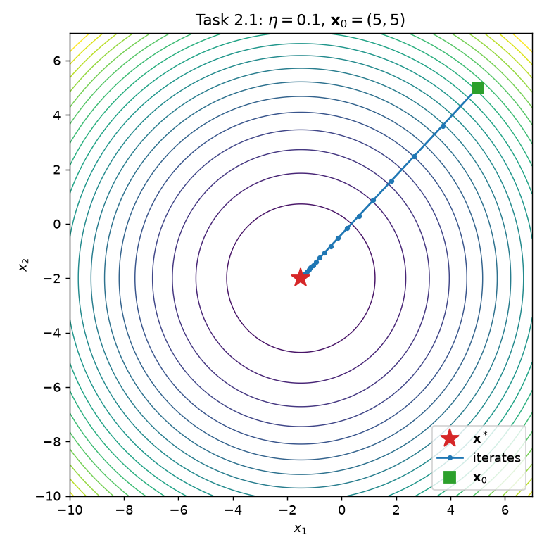

| final $\mathbf x$ | $f$ | $\lVert\nabla f\rVert$ | updates | status |
|---|---|---|---|---|
| $(-1.4999997196,\;-1.9999996980)$ | $-1.25$ | $8.24\times10^{-7}$ | 76 | `converged` |

The iterates move along a **straight line** toward $\mathbf x^*$, crossing the circular contours at right angles, with geometrically shrinking steps (factor 0.8).

### Task 2.2: Different learning rates ($\mathbf x_0=(5,5)^\top$)

**Prediction.** $\mathbf e_{k+1}=(1-2\eta)\mathbf e_k$ (Task 2.4), so the multipliers are $0.8$, $0$ and $-1$:
* $\eta=0.1$: straight-line, monotone convergence.
* $\eta=0.5$: lands on $\mathbf x^*$ in one step.
* $\eta=1.0$: jumps to $\mathbf x^*-\mathbf e_0=(-8,-9)$ and back forever.

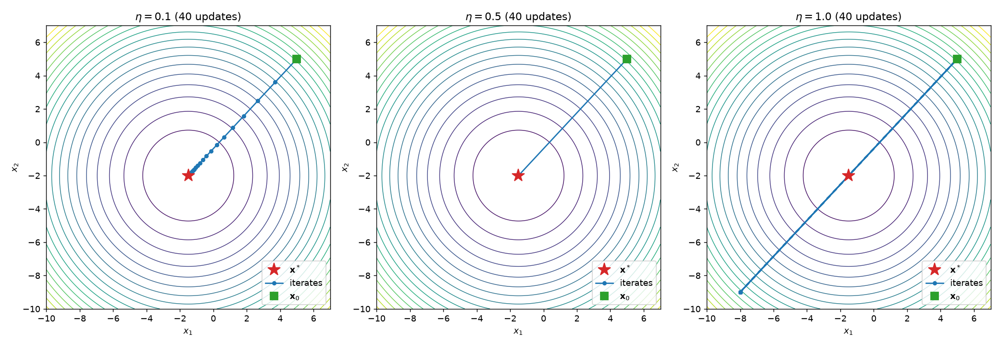

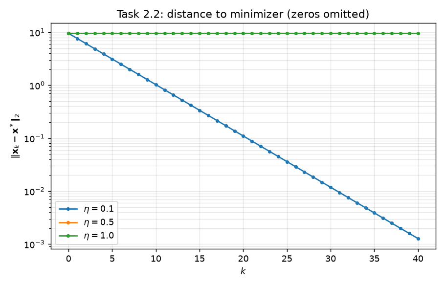

Identical contour levels and axis limits are used in all three panels. For $\eta=0.5$, $\|\mathbf e_k\|=0$ for $k\ge1$ and is omitted on the log axis.

| $\eta$ | Init. | Updates | Status (40-run) | final $\lVert\nabla f\rVert$ | final $f$ | Convergence run | Fixed-point classification |
|---|---|---|---|---|---|---|---|
| 0.1 | (5,5) | 40 | `max_iter` | $2.54\times10^{-3}$ | $-1.25$ (−1.249998) | 76, `converged` | **asymptotically stable** |
| 0.5 | (5,5) | 40 | `max_iter` | $0$ | $-1.25$ | 1, `converged` | **asymptotically stable** (one step) |
| 1.0 | (5,5) | 40 | `max_iter` | $19.1$ | $90$ | 10 000, `max_iter` | **stable but not attracting** |

**Does a bounded orbit necessarily converge? No.** At $\eta=1$, the orbit $(5,5)\to(-8,-9)\to(5,5)\to\cdots$ is bounded, with $\|\mathbf e_k\|=9.55$ for all $k$, but it is periodic and never converges. Boundedness only rules out divergence.

These classifications hold for **every** starting point, not just $(5,5)$, because they follow from the eigenvalues of $I-\eta H$ (Task 2.4):
* $|0.8|<1$ and $|0|<1$ mean asymptotically stable.
* $|-1|=1$ with a diagonalizable matrix means the error norm is preserved: stable but not attracting.
* Any $\eta>1$ would make the fixed point unstable.

### Task 2.3: Different starting points ($\eta=0.1$)

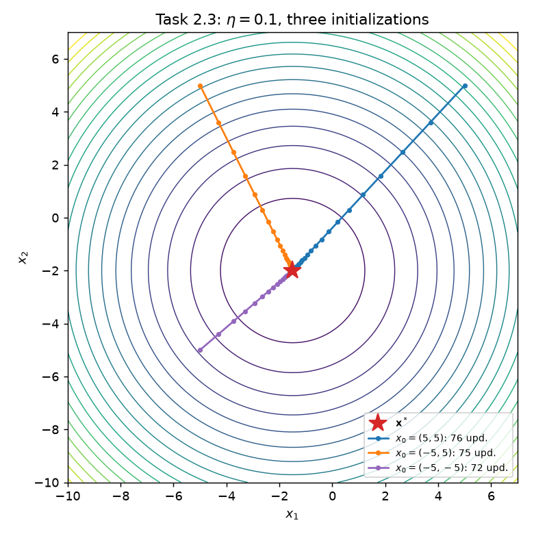

| $\mathbf x_0$ | $\lVert\mathbf e_0\rVert$ | approach direction $\mathbf e_0/\lVert\mathbf e_0\rVert$ | Updates | Status | final $\lVert\nabla f\rVert$ | final $f$ |
|---|---|---|---|---|---|---|
| (5, 5) | 9.553 | (0.680, 0.733) | 76 | `converged` | $8.24\times10^{-7}$ | $-1.25$ |
| (−5, 5) | 7.826 | (−0.447, 0.894) | 75 | `converged` | $8.44\times10^{-7}$ | $-1.25$ |
| (−5, −5) | 4.610 | (−0.759, −0.651) | 72 | `converged` | $9.71\times10^{-7}$ | $-1.25$ |

Initialization affects three things differently:
* **Limiting minimizer:** unchanged. All runs reach $\mathbf x^*=(-1.5,-2)$, since $f$ is strictly convex with a unique stationary point.
* **Direction of approach:** changed. Each run comes in radially along its own $\mathbf e_0$.
* **Number of updates:** changed, but only through $\|\mathbf e_0\|$, giving $k=\lceil\ln(2\|\mathbf e_0\|/10^{-6})/\ln1.25\rceil=76,75,72$.

So initialization changes the direction and the update count, **not** the limit.

### Task 2.4: Stability, curvature and the shape of the path

$$H=\nabla^2f=\begin{pmatrix}2&0\\0&2\end{pmatrix}=2I,\qquad DF_\eta=I-\eta H=(1-2\eta)I .$$

**Exact error relation.** $\nabla f(\mathbf x)=H\mathbf x+\mathbf c$ with $\mathbf c=(3,4)^\top$, and $\nabla f(\mathbf x^*)=\mathbf 0$, so $\nabla f(\mathbf x_k)=\nabla f(\mathbf x_k)-\nabla f(\mathbf x^*)=H\mathbf e_k$. Hence
$$\mathbf e_{k+1}=\mathbf e_k-\eta H\mathbf e_k=(I-\eta H)\mathbf e_k,\qquad\mathbf e_k=(1-2\eta)^k\mathbf e_0 .$$

**Eigenvalues:** $1-2\eta$ (double), with every vector an eigenvector. The iteration converges iff $|1-2\eta|<1$, i.e. $\boxed{0<\eta<1}$. This matches $0<\eta<2/\lambda_{\max}(H)=2/2$. The code confirms eigenvalues $[0.8,0.8]$, $[0,0]$ and $[-1,-1]$ for $\eta=0.1,0.5,1$.

**Why no higher-order remainder is needed.** In general, $\nabla f(\mathbf x^*+\mathbf e)=H(\mathbf x^*)\mathbf e+O(\|\mathbf e\|^2)$, so linearization is only valid locally. For a quadratic, $\nabla f$ is *affine*: all third derivatives vanish, so the Taylor expansion of the gradient terminates after the linear term. The linear error recursion is therefore exact and global. That is why the stability interval is a global statement.

**Why the path is a straight line.** $\mathbf e_k=(1-2\eta)^k\mathbf e_0$ is a scalar multiple of $\mathbf e_0$, so every iterate lies on the line $\{\mathbf x^*+t\,\mathbf e_0:t\in\mathbb R\}$ through $\mathbf x^*$ and $\mathbf x_0$. Numerically, the 2D cross product $\mathbf e_k\times\mathbf e_0$ stays below $4\times10^{-15}$ over 40 updates. This happens because $H$ is a multiple of the identity: the gradient always points exactly at $\mathbf x^*$.

**Must alternating iterates stay on the segment $[\mathbf x_0,\mathbf x^*]$? No.** If $1-2\eta<0$, then $t_k=(1-2\eta)^k$ alternates sign. The odd iterates lie on the line but on the *other side* of $\mathbf x^*$, i.e. on the extension of the segment beyond $\mathbf x^*$. For $\eta=1$, $\mathbf x_1=(-8,-9)=\mathbf x^*-\mathbf e_0$ is far outside the segment from $(5,5)$ to $(-1.5,-2)$. The iterates stay on the *line*, not the *segment*.

---

## Problem 3: Linear regression as a dynamical system

### Dataset 1: one input feature, two parameters

$X=(1,2,3,4,5)$ and $Y=(2,4,6,8,10)$. The model is $\hat y=wx+b$ with $L(w,b)=\frac1n\sum_i(wx_i+b-y_i)^2$ and $n=5$.

#### Task 3A.1: Parameter updates

With residuals $r_i=wx_i+b-y_i$:
$$\frac{\partial L}{\partial w}=\frac2n\sum_{i=1}^n r_i x_i,\qquad\frac{\partial L}{\partial b}=\frac2n\sum_{i=1}^n r_i .$$

The two coefficients are updated **simultaneously**, from the same residuals of the current $(w_k,b_k)$:
$$w_{k+1}=w_k-\eta\,\frac2n\sum_i r_i^{(k)}x_i,\qquad b_{k+1}=b_k-\eta\,\frac2n\sum_i r_i^{(k)},\qquad r_i^{(k)}=w_kx_i+b_k-y_i.$$

```python
A1 = np.column_stack([X, np.ones(n)])
def mse_loss(A, y): return lambda th: float(np.mean((A @ th - y)**2))
def mse_grad(A, y): return lambda th: (2.0/len(y)) * A.T @ (A @ th - y)   # same residuals for all coefficients
```

The vectorized gradient matches the explicit scalar formulas to $1.8\times10^{-15}$. At $\theta_0=(0,0)$, $L=44$ and $\nabla L=(-44,-12)$.

**Convergence run** with $\eta=1/\lambda_{\max}(H)$ (Task 3A.2) and $\theta_0=(0,0)^\top$:

| $\eta$ | Init. | $w$ | $b$ | MSE | $\lVert\nabla L\rVert$ | Updates | Status |
|---|---|---|---|---|---|---|---|
| 0.0422620 | (0,0) | 1.9999992217 | $2.81\times10^{-6}$ | $1.44\times10^{-12}$ | $9.86\times10^{-7}$ | 842 | `converged` |

**Expected fit from the data:** $y_i=2x_i$ exactly, so $w=2$, $b=0$ and MSE $=0$. Gradient descent agrees to within $3\times10^{-6}$.

#### Task 3A.2: Choosing the learning rate from the curvature

With $A=[X\;\mathbf 1]$ we have $\hat{\mathbf y}=A\theta$ and $\mathbf r=A\theta-\mathbf y$. This gives
$$L(\theta)=\tfrac1n\|A\theta-\mathbf y\|_2^2,\quad\nabla L=\tfrac2nA^\top(A\theta-\mathbf y),\quad H=\nabla^2L=\tfrac2nA^\top A .$$

These agree with 3A.1: the two rows of $A^\top\mathbf r$ are $\sum r_ix_i$ and $\sum r_i$.

$$A^\top A=\begin{pmatrix}55&15\\15&5\end{pmatrix},\qquad H=\frac25A^\top A=\begin{pmatrix}22&6\\6&2\end{pmatrix}.$$

The eigenvalues are $\lambda=12\pm\sqrt{136}$, i.e. $\lambda_{\min}=0.338096$ and $\lambda_{\max}=23.661904$ (condition number $\approx70$).

| Quantity | Value |
|---|---|
| $\eta=1/\lambda_{\max}$ | 0.0422620263 |
| upper bound $2/\lambda_{\max}$ | **0.0845240526** |
| multipliers $1-\eta\lambda_i$ | 0.98571, 0 |

**Why $\eta=1/\lambda_{\max}$ is stable.** As in Problem 2, $\mathbf e_{k+1}=(I-\eta H)\mathbf e_k$ holds exactly. Since $H$ is symmetric positive definite, convergence holds iff $|1-\eta\lambda_i|<1$ for all $i$, i.e. $0<\eta<2/\lambda_{\max}$. The choice $\eta=1/\lambda_{\max}$ sits in the middle of this interval:
* the stiff direction is killed in one step (multiplier 0);
* the flat direction contracts by $1-\lambda_{\min}/\lambda_{\max}=0.9857$ per step.

That slow multiplier is why 842 updates are needed.

**Prediction for $\eta=0.1$.** $0.1>0.0845$, so the multipliers are $1-0.1\lambda=0.966$ and $\mathbf{-1.366}$. The component of the error along the top eigenvector will oscillate and grow by a factor of 1.366 per step, so the run will diverge.

| $\eta$ | Init. | Updates | Status (40-run) | final $\lVert\nabla L\rVert$ | final MSE | Behavior |
|---|---|---|---|---|---|---|
| 0.1 | (0,0) | 40 | `max_iter` | $1.20\times10^{7}$ | $3.05\times10^{12}$ | **unstable (divergent oscillation)** |

The MSE grows from $44\to2.3\times10^4\to1.2\times10^7\to5.9\times10^9\to3.0\times10^{12}$ at $k=0,10,20,30,40$. At $k=40$, $\|\theta\|\approx5.1\times10^5$, which is still below the $10^6$ safety threshold, so the status is `max_iter`. The mathematical classification still comes from $|{-1.366}|>1$.

**Why a learning rate that worked before fails here.** The stability condition depends on $\eta\lambda_{\max}$, not on $\eta$ alone. In Problems 1 and 2, $\lambda=2$, so any $\eta<1$ works. Here the curvature is set by the data, $H=\frac2nA^\top A$. Inputs up to 5 make $\frac2n\sum x_i^2=22$, so $\lambda_{\max}\approx23.7$ and the admissible interval shrinks to $\eta<0.0845$. Rescaling the features, or changing the loss normalization (e.g. using $\frac1{2n}$, which halves $H$ and doubles the bound), changes the admissible interval.

#### Task 3A.3: Visualization and validation

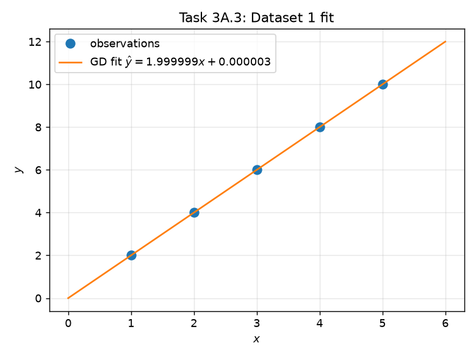

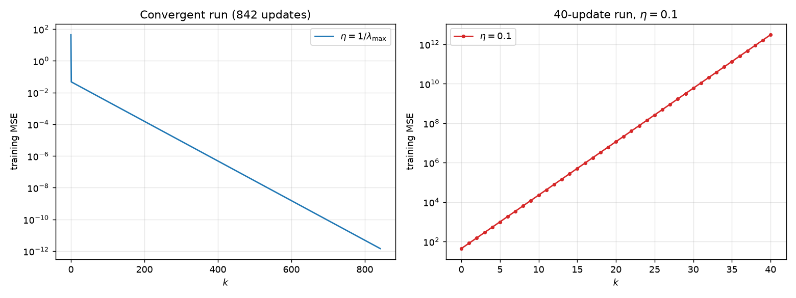

Left: the training MSE of the convergent run decreases geometrically at the slow rate $0.9857^2$ per step after the first update. Right: the $\eta=0.1$ run for contrast.

| | $w$ | $b$ | MSE |
|---|---|---|---|
| Gradient descent | 1.9999992217 | $2.8099\times10^{-6}$ | $1.437\times10^{-12}$ |
| `np.linalg.lstsq` | 2.0000000000 | $1.0\times10^{-16}$ | $1.0\times10^{-30}$ |
| abs. difference | $7.8\times10^{-7}$ | $2.8\times10^{-6}$ | $1.4\times10^{-12}$ |

The differences are of the size implied by the stopping tolerance $\|\nabla L\|<10^{-6}$. They are not exact zeros, which is expected for an iterative method in floating point.

---

### Dataset 2: two input features, three parameters

$X_1=(1,2,3,4,5)$, $X_2=(2,3,4,5,6)$ and $Y=(2,3,5,6,8)$. The model is $\hat y=w_1x_1+w_2x_2+b$.

#### Task 3B.1: Information in the inputs (before fitting)

On the data, $x_2=x_1+1$, so
$$\hat y=w_1x_1+w_2(x_1+1)+b=\underbrace{(w_1+w_2)}_{\alpha}x_1+\underbrace{(w_2+b)}_{\beta}.$$

The predictions on the training inputs depend only on $(\alpha,\beta)$. The map $(w_1,w_2,b)\mapsto(\alpha,\beta)$ goes from $\mathbb R^3$ to $\mathbb R^2$ and has a one-dimensional kernel spanned by $\mathbf v=(1,-1,1)^\top$: moving by $t\mathbf v$ changes $\alpha$ by $t-t=0$ and $\beta$ by $-t+t=0$.

**The three coefficients cannot be uniquely recovered** from observations restricted to this input line. At best, the data determine $\alpha$ and $\beta$. Every $\theta$ with the same $(\alpha,\beta)$ fits the data identically.

The data do determine the best $(\alpha,\beta)$ uniquely, by simple regression of $y$ on $x_1$: $\alpha=S_{xy}/S_{xx}=15/10=1.5$ and $\beta=\bar y-\alpha\bar x=4.8-4.5=0.3$. The residuals $r_i=\hat y_i-y_i$ are $(-0.2,0.3,-0.2,0.3,-0.2)$, so the minimum MSE is $0.06$ (not zero). The set of minimizers is the line
$$\theta(t)=(0.9,\,0.6,\,-0.3)+t\,(1,-1,1),\qquad t\in\mathbb R.$$

#### Task 3B.2: Implementing and fitting the model

With $r_i=w_1x_{1i}+w_2x_{2i}+b-y_i$:
$$\frac{\partial L}{\partial w_1}=\frac2n\sum r_ix_{1i},\quad\frac{\partial L}{\partial w_2}=\frac2n\sum r_ix_{2i},\quad\frac{\partial L}{\partial b}=\frac2n\sum r_i ,$$
and all three are updated simultaneously from the same residuals. This is the same `mse_grad(A, y)` as before, with $A=[X_1\;X_2\;\mathbf 1]$.

$$A^\top A=\begin{pmatrix}55&70&15\\70&90&20\\15&20&5\end{pmatrix},\qquad H=\frac25A^\top A=\begin{pmatrix}22&28&6\\28&36&8\\6&8&2\end{pmatrix}.$$

* **Rank of $A$: 2.** The column dependence is exact: $X_1-X_2+\mathbf 1=\mathbf 0$, i.e. $A\mathbf v=\mathbf 0$ with $\mathbf v=(1,-1,1)^\top$. The code returns `A @ v = [0 0 0 0 0]` and `H @ v = [0 0 0]` exactly.
* **Eigenvalues of $H$:** $\lambda_1=0$, plus the roots of $\lambda^2-60\lambda+24=0$, i.e. $\lambda=30\pm\sqrt{876}$:
  $$\lambda_1=0,\quad\lambda_2=0.402703,\quad\lambda_3=59.597297.$$
  `eigvalsh` reports $\lambda_1=2.6\times10^{-15}$. This is round-off, and it is treated as an exact zero *because* $H\mathbf v=\mathbf 0$ was verified exactly.
* $\eta=1/\lambda_{\max}=0.0167792844$, with bound $2/\lambda_{\max}=0.0335585688$.

| $\eta$ | Init. | $w_1$ | $w_2$ | $b$ | MSE | $\lVert\nabla L\rVert$ | Updates | Status |
|---|---|---|---|---|---|---|---|---|
| 0.0167793 | (0,0,0) | 0.899998645 | 0.600000622 | −0.299998023 | 0.0600000000012 | $9.97\times10^{-7}$ | 1824 | `converged` |

**Check against `np.linalg.lstsq`.** It returns $\theta_{\rm ref}=(0.9,0.6,-0.3)$ and rank 2. Its `residuals` output is an **empty array**, because NumPy returns residuals only for full-rank systems. An empty array is **not** a zero-error certificate. Computed explicitly, $\text{mse\_ref}=\frac1n\|A\theta_{\rm ref}-\mathbf y\|^2=0.060000000000$.

| | GD from $\theta_0=0$ | `lstsq` | max abs. difference |
|---|---|---|---|
| predictions on $X$ | (1.800002, 3.300001, 4.800000, 6.300000, 7.799999) | (1.8, 3.3, 4.8, 6.3, 7.8) | $1.9\times10^{-6}$ |
| MSE | 0.0600000000012 | 0.06 | $1.2\times10^{-12}$ |
| coefficients | (0.899999, 0.600001, −0.299998) | (0.9, 0.6, −0.3) | $2.0\times10^{-6}$ |

The coefficients agree with `lstsq` here because `lstsq` returns the **minimum-norm** least-squares solution, and gradient descent from $\theta_0=\mathbf 0$ converges to that same solution (see E3). Its fitted $(\alpha,\beta)=(1.5,0.3)$ matches the prediction from 3B.1.

#### Task 3B.3: Different parameter limits, same predictions

The fit is repeated from $\tilde\theta_0=(1,-1,1)^\top$ with the same $\eta$ and stopping rule.

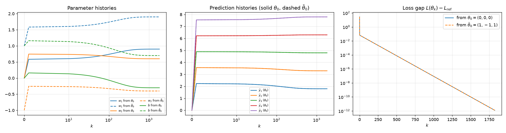

| | $w_1$ | $w_2$ | $b$ | $\alpha=w_1+w_2$ | $\beta=w_2+b$ | MSE | Updates | Status |
|---|---|---|---|---|---|---|---|---|
| from $\theta_0=(0,0,0)$ | 0.899998645 | 0.600000622 | −0.299998023 | 1.4999993 | 0.3000026 | 0.06 | 1824 | `converged` |
| from $\tilde\theta_0=(1,-1,1)$ | 1.899998645 | −0.399999378 | 0.700001977 | 1.4999993 | 0.3000026 | 0.06 | 1824 | `converged` |
| **difference** | **1.000000** | **−1.000000** | **1.000000** | 0 | 0 | $<4\times10^{-16}$ | | |

**Observations.**
* The **parameter histories differ**: the dashed curves are offset from the solid ones. The **prediction histories and loss curves are identical** to machine precision ($\max_k\|\tilde\theta_k-\theta_k-\mathbf v\|=1.6\times10^{-15}$ and $\max_k|L(\tilde\theta_k)-L(\theta_k)|=3\times10^{-16}$). Both runs need the same 1824 updates.
* **Explanation via the reduced model.** $\tilde\theta_0-\theta_0=(1,-1,1)=\mathbf v$ lies in the null space of $A$. Both starts give $\alpha=\beta=0$, so they produce identical residuals and therefore identical gradients $\nabla L=\frac2nA^\top\mathbf r$. Every update is the same, so $\tilde\theta_k=\theta_k+\mathbf v$ for all $k$. The two runs describe the same trajectory in $(\alpha,\beta)$ space, shifted along the direction the data cannot see.
* **Is the second vector an incorrect fit? No.** It has the same predictions and the same (minimal) training loss as the reference, so it is an equally valid least-squares solution. "Different from `lstsq`" is not an error criterion when the minimizer is not unique. `lstsq` simply picks the minimum-norm member of the solution set.
* **What a zero Hessian eigenvalue suggests.** The loss is exactly flat along $\mathbf v$: $L(\theta+t\mathbf v)=L(\theta)$. A minimizer of a convex quadratic is unique iff $H\succ0$. A zero eigenvalue means the minimizers form an affine set (here a line), so the data do not determine a unique parameter vector.

#### Task 3B.4: Visualizing the fit without implying unsupported information

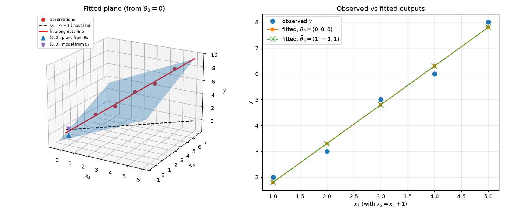

**Left:** the plane fitted from $\theta_0=0$, with the observations in $(x_1,x_2,y)$ space. **Right:** observed and fitted outputs against $X_1$. The two fitted models coincide at every training input.

All observations lie on the **line $x_2=x_1+1$** in the input plane (dashed black line on the left). The data therefore explore a one-dimensional set of inputs, not a two-dimensional region. The data constrain the fitted plane only along that line, the red line. The tilt of the plane *across* the line is not determined by the data. Any plane containing the red line fits equally well, and the family $\theta(t)$ of Task 3B.1 is exactly that one-parameter "hinge" of planes.

**Off-line prediction at $(x_1,x_2)=(0,0)$**, which is not a training point and not on the input line:

| Model | $\hat y(0,0)=b$ |
|---|---|
| from $\theta_0=(0,0,0)$ | −0.299998 |
| from $\tilde\theta_0=(1,-1,1)$ | 0.700002 |

The two models differ by exactly 1. In general, $\hat y_{\tilde\theta}(x)-\hat y_\theta(x)=\mathbf v^\top(x_1,x_2,1)=x_1-x_2+1$. This is zero for every point on the line $x_2=x_1+1$ and nonzero everywhere else. Agreement on the training inputs therefore says nothing about off-line inputs, which is a form of extrapolation. Since no target value is given at $(0,0)$, **neither prediction can be called more accurate**: they are two different extrapolations that the data cannot decide between.

**Three distinct questions.**

| Question | Dataset 2 answer |
|---|---|
| Does the loss converge? | Yes, to the minimum 0.06, from both starts. |
| Do the parameters converge? | Yes. Each run converges to a definite vector, since the multipliers are $0$, $0.993$ and exactly $1$ on the invariant direction. |
| Is the limit uniquely determined by the data? | **No.** It depends on $\theta_0$ through $\mathbf v^\top\theta_0$. |

---

## Optional extension E3: The flat direction in Dataset 2

**Null vector.** $\mathbf v=(1,-1,1)^\top$ satisfies $A\mathbf v=X_1-X_2+\mathbf 1=\mathbf 0$.

**Invariant.** With $\nabla L(\theta)=\frac2nA^\top(A\theta-\mathbf y)$:
$$\mathbf v^\top\theta_{k+1}=\mathbf v^\top\theta_k-\eta\frac2n\,\mathbf v^\top A^\top(A\theta_k-\mathbf y)=\mathbf v^\top\theta_k-\eta\frac2n\,(A\mathbf v)^\top(A\theta_k-\mathbf y)=\mathbf v^\top\theta_k .$$

Every gradient lies in $\operatorname{range}(A^\top)=\mathbf v^\perp$, so gradient descent never moves along $\mathbf v$. Numerically, $\mathbf v^\top\theta_k$ stays at 0 (run A) and 3 (run B), with drift below $4\times10^{-15}$.

**Dependence of the limit on initialization.** Decompose $\theta=\theta_\perp+\frac{\mathbf v^\top\theta}{\|\mathbf v\|^2}\mathbf v$.
* The $\mathbf v^\perp$ part converges to the unique minimizer *within* $\mathbf v^\perp$, which is the minimum-norm solution $\theta_{\rm mn}=(0.9,0.6,-0.3)$.
* The $\mathbf v$ part is frozen.

Hence
$$\lim_{k\to\infty}\theta_k=\theta_{\rm mn}+\frac{\mathbf v^\top\theta_0}{\|\mathbf v\|^2}\,\mathbf v .$$

* For $\theta_0=\mathbf 0$, this gives $\theta_{\rm mn}$, which is why GD from zero reproduces `lstsq`.
* For $\tilde\theta_0=(1,-1,1)$, $\mathbf v^\top\tilde\theta_0/\|\mathbf v\|^2=3/3=1$, so the limit is $(1.9,-0.4,0.7)$, exactly what was observed.

**Eigenvalues of $I-\eta H$** for $\eta=1/\lambda_{\max}$:

| $H$ eigenvalue | $1-\eta\lambda$ | Effect |
|---|---|---|
| $\lambda_3=59.597$ | $0$ | stiff direction killed in one step |
| $\lambda_2=0.4027$ | $0.993243$ | slow contraction (sets the 1824 updates) |
| $\lambda_1=0$ (direction $\mathbf v$) | $\mathbf 1$ | neither contracts nor grows |

**Stable but not asymptotically stable.** Take any minimizer $\theta^\dagger$ and perturb it by $\boldsymbol\delta$. Then $\boldsymbol\delta_k=(I-\eta H)^k\boldsymbol\delta$. The matrix $I-\eta H$ is symmetric with eigenvalues in $[0,1]$, so $\|\boldsymbol\delta_k\|\le\|\boldsymbol\delta\|$: the iterates never move farther away, which is Lyapunov stability. The component of $\boldsymbol\delta$ along $\mathbf v$ has multiplier exactly 1 and never decays. The iterates therefore converge to a *different* minimizer $\theta^\dagger+\frac{\mathbf v^\top\boldsymbol\delta}{3}\mathbf v$, not back to $\theta^\dagger$. So $\theta^\dagger$ is not attracting, and hence not asymptotically stable.

**Distance to the solution set still tends to zero.** The distance to the solution *set* $\{\theta_{\rm mn}+t\mathbf v\}$ depends only on the $\mathbf v^\perp$ component of the error. That component sees multipliers $0$ and $0.9932$, so it decays geometrically. Numerically, the distance goes from $1.1225$ to $2.5\times10^{-6}$ for both runs. The **set** of minimizers is attracting, even though no individual minimizer is.

---

## Summary table of all convergence runs

| Problem | $\eta$ | Initialization | Updates | Stop reason | final $\lVert\nabla\rVert$ | final loss | Mathematical behavior |
|---|---|---|---|---|---|---|---|
| P1 | 0.1 | 10 | 76 | converged | $9.9\times10^{-7}$ | −0.25 | monotone convergence ($q=0.8$) |
| P1 | 0.5 | 10 | 1 | converged | 0 | −0.25 | one-step ($q=0$) |
| P1 | 0.6 | 10 | 11 | converged | $4.7\times10^{-7}$ | −0.25 | oscillatory convergence ($q=-0.2$) |
| P1 | 0.9 | 10 | 76 | converged | $9.9\times10^{-7}$ | −0.25 | oscillatory convergence ($q=-0.8$) |
| P1 | 1.0 | 10 | 10 000 | max_iter | 23 | 132 | 2-cycle, stable not attracting |
| P1 | 1.1 | 10 | 63 | safety_stop | $2.2\times10^{6}$ | $1.25\times10^{12}$ | unstable ($q=-1.2$) |
| P1 | 0.1 | −5 | 71 | converged | $9.2\times10^{-7}$ | −0.25 | monotone convergence |
| P1 | 0.1 | 0 | 67 | converged | $9.6\times10^{-7}$ | −0.25 | monotone convergence |
| P2 | 0.1 | (5,5) | 76 | converged | $8.2\times10^{-7}$ | −1.25 | asymptotically stable |
| P2 | 0.5 | (5,5) | 1 | converged | 0 | −1.25 | asymptotically stable (one step) |
| P2 | 1.0 | (5,5) | 10 000 | max_iter | 19.1 | 90 | stable, not attracting |
| P2 | 0.1 | (−5,5) | 75 | converged | $8.4\times10^{-7}$ | −1.25 | asymptotically stable |
| P2 | 0.1 | (−5,−5) | 72 | converged | $9.7\times10^{-7}$ | −1.25 | asymptotically stable |
| 3A | 0.04226 | (0,0) | 842 | converged | $9.9\times10^{-7}$ | $1.4\times10^{-12}$ | asymptotically stable |
| 3A | 0.1 (40-run) | (0,0) | 40 | max_iter | $1.2\times10^{7}$ | $3.0\times10^{12}$ | unstable (multiplier −1.366) |
| 3B | 0.01678 | (0,0,0) | 1824 | converged | $1.0\times10^{-6}$ | 0.06 | converges; minimizer not unique |
| 3B | 0.01678 | (1,−1,1) | 1824 | converged | $1.0\times10^{-6}$ | 0.06 | converges to a different minimizer |

---

## Synthesis

Gradient descent is a discrete dynamical system. Near a minimizer, its behavior is governed by the multipliers $1-\eta\lambda$, where $\lambda$ are the Hessian eigenvalues. The learning rate and the curvature act together: only the product $\eta\lambda$ matters, and the iteration is stable exactly when $0<\eta<2/\lambda_{\max}$. That is why $\eta=0.1$ converges in Problems 1–2, where $\lambda=2$, but diverges on Dataset 1, where $\lambda_{\max}\approx23.7$. Inside the stable range:
- multipliers near 1 give a slow monotone approach;
- negative multipliers give oscillation;
- $\eta\lambda=1$ gives one-step convergence;
- $\eta\lambda=2$ gives a bounded two-cycle that never converges.

Initialization does not change the limit of a strictly convex problem. It changes the direction of approach, and through $\log\|\mathbf e_0\|$, the number of updates. Oscillations can coexist with a decreasing loss because a quadratic loss gap depends on $e_k^2$, not on the sign of $e_k$. Any $|q|<1$ shrinks it, even when $q<0$.

Dataset 2 separates convergence from uniqueness. The loss and the parameters both converge. However, a zero Hessian eigenvalue creates a flat direction $\mathbf v=(1,-1,1)$ along which gradient descent never moves. The limit therefore depends on $\theta_0$, and the data cannot identify a unique coefficient vector.
